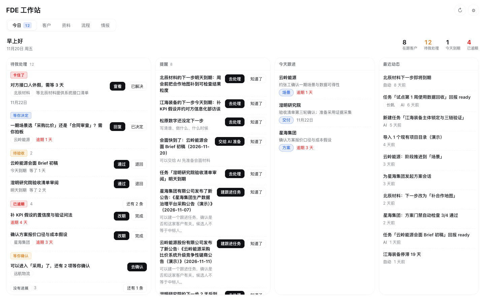
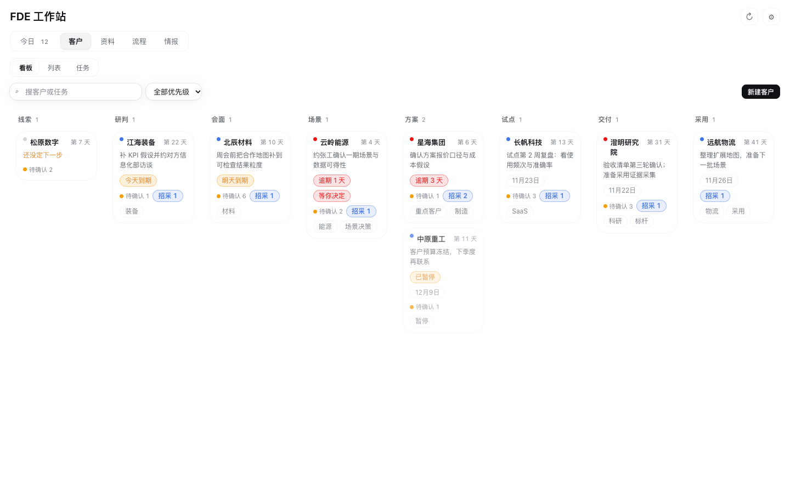
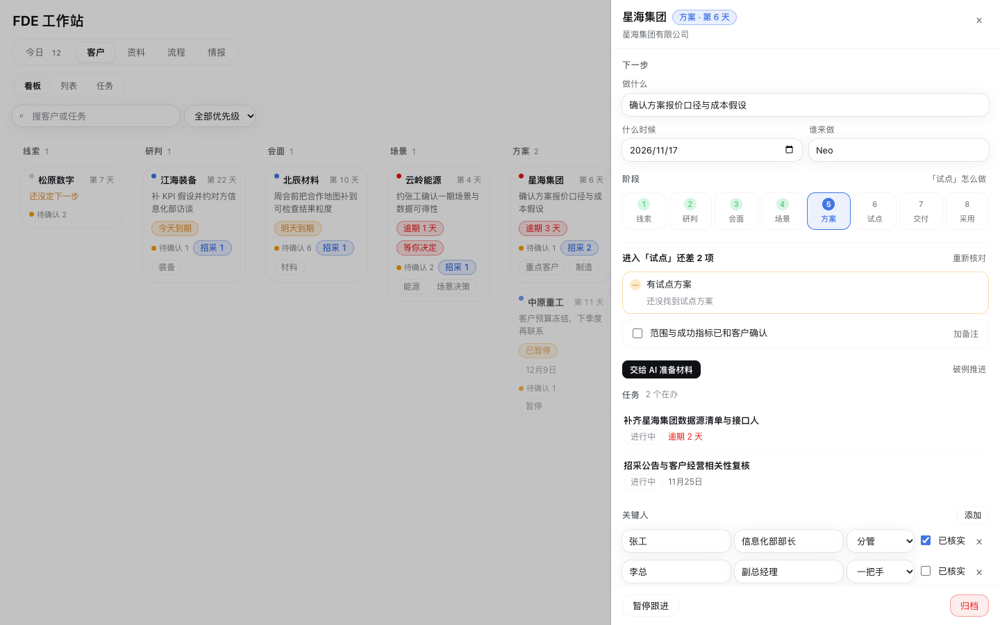

# FDE 工作站（`dsh-fde`）· DSH 插件

[](https://github.com/NeoJubao/dsh-fde/actions/workflows/verify.yml) [](https://github.com/NeoJubao/dsh-fde/blob/main/LICENSE) [](https://github.com/NeoJubao/dsh-fde/blob/main/LICENSE-docs)

> 一屏看清每个客户到哪一步、今天要处理什么、还差什么才能往下走，并把活交给 AI 去做。
> 跑在 [DeepSeek Harness](https://github.com/deepseek-ai/deepseek-harness)（DSH）里，中文界面，纯 JS，零运行时依赖。
> **版本：v2.0.0** ｜ DSH：`0.2.0-rc.2` 起，已在 `0.2.1-rc.5` 上核对，桌面端 `0.2.2-rc.5` 实测通过 ｜ 许可：代码 MIT / 内容 CC BY 4.0



做 FDE、解决方案或售前，手上总有一把客户。难的是每天要回答四个问题：今天该推谁、卡在哪、还差什么材料、交给 AI 的活做完了没有。这个插件把这些状态放到一个面板里：

- **客户**沿 8 个阶段推进：线索 → 研判 → 会面 → 场景 → 方案 → 试点 → 交付 → 采用。进入下一阶段有**推进条件**：一部分是材料（系统自动核对），一部分需要你确认。
- **今日**只放两类事：**待我处理**（卡住了、等你决定、待验收、已逾期……每条都有处理动作）和**提醒**（快到期、没定下一步、会面快到了、客户有新招采公告）。
- **交给 AI**：在客户或任务上点一下，新开一个会话，AI 按要进入的那个阶段的做法，准备还差的材料，做完回到面板等你验收。
- **任务**在 5 个状态间流转：待开始 / 进行中 / 等对方 / 待验收 / 已完成。
- **方法和技能随插件带着**：8 篇方法、16 个技能，离线可读。

推进阶段、确认推进条件、标记验收完成、对外发送材料、删除客户或任务，这些事**只能由你来做**，AI 做不了。

## 安装

需要 DSH `0.2.0-rc.2` 或更新（带 Web 界面）、Node 20 或更新。

```bash
# 方式一：npm 包（推荐）
dsh plugin --profile web add dsh-fde

# 方式二：从 GitHub 安装（main 分支是最新代码）
git clone https://github.com/NeoJubao/dsh-fde.git
dsh plugin --profile web add ./dsh-fde

# 方式三：压缩包
npm pack ./dsh-fde && dsh plugin --profile web add ./dsh-fde-2.0.0.tgz
```

装好后**重启 DSH**，侧栏出现「FDE 工作站」。第一次用，先看 [10 分钟上手教程](https://github.com/NeoJubao/dsh-fde/blob/main/docs/GETTING-STARTED.md)。

安装前想先检查环境（只检查，不改 DSH 的配置）：

```bash
python3 tools/install_profiles.py          # 检查环境并打印安装命令
python3 tools/install_profiles.py --run    # 检查后执行安装
```

卸载：`dsh plugin --profile web remove dsh-fde`。想把看板清空重来：删除工作区的 `research/.fde/`，客户文件夹 `research/<客户>/` 不受影响。

## 第一次使用

1. 打开「FDE 工作站」。还没有客户时会显示一组**示例数据**（只能看，不会保存）；点「开始使用」换成你自己的。
2. 「新建客户」，或「导入已有文件夹」——插件会在工作区的 `research/` 下找已有的客户文件夹，勾选后导入，文件不会被改动。
3. 在「客户 → 看板」点开一个客户：先写**下一步**；下面是进入下一阶段还差什么。缺材料就点「交给 AI 准备材料」。
4. 每天打开看「今日」：左边是等你处理的事，旁边是提醒。

客户文件夹在 `<工作区>/research/<客户>/`；看板数据在 `<工作区>/research/.fde/`，只由插件读写。

## 面板

5 个页签，设置在右上角的齿轮里。

| 页签 | 页内 | 用来做什么 |
|---|---|---|
| **今日** | — | 一屏四块：待我处理 / 提醒 / 今天跟进 / 最近动态 |
| **客户** | 看板 / 列表 / 任务 | 8 个阶段的客户看板（可拖动）、客户列表与筛选、任务看板；新建客户、导入已有文件夹、新建任务 |
| **资料** | — | 客户文件夹里的文件：搜索、筛选、在面板里直接预览（md / PDF / 图片 / 网页快照 / Office） |
| **流程** | 阶段指南 / 方法库 / 技能与模板 | 每个阶段要达成什么、要做的事、要交出来的、容易踩的坑、进入条件；方法全文；技能清单 |
| **情报** | 资料库 / 招采 | 人工挑选的权威资料与开源工具；本地招采公告查询与客户关联 |
| 设置 | 右上角齿轮 | AI 权限、提醒、数据来源、示例数据、运行状态 |





键盘操作：看板卡片可以用 Tab 选中、Enter 打开、Alt + ← / → 换列；资料页的分隔条可以用 ← / → 调宽度。

## AI 能做什么

设置里的「AI 权限」有两档：

- **只提醒，由我决定**（默认）：AI 只提醒，不替你改任何东西。
- **小事可以直接处理**：AI 可以给没定下一步的客户补一条待确认的下一步，为新招采公告建跟进任务。

不管选哪一档，推进客户阶段、确认推进条件、标记交付或验收完成、导出或发送对外材料、删除客户或任务、修改客户文件夹里的定稿文件，都只能由你来做。

## 工具与技能

会话里的 AI 通过这些工具读写看板、按技能做事。工具名和技能名是给 AI 用的标识，面板上不需要记。

| 类别 | 清单 |
|---|---|
| 看板与客户工具（11） | `fde_board` · `fde_engagement` · `fde_item` · `fde_attention` · `fde_brief` · `fde_harvest` · `fde_bid` · `fde_library` · `fde_scenario` · `fde_quote` · `scys_fde` |
| 执行工具（5） | `rw_status` · `rw_scaffold` · `rw_export_pdf` · `rw_qa_pdf` · `rw_method` |
| 阶段技能（11） | `fde-engagement` / `fde-discovery` / `fde-meeting` / `fde-scoping` / `fde-solution` / `fde-pilot` / `fde-delivery` / `fde-adoption` / `fde-board` / `fde-harvest` / `fde-bid-radar` |
| 方法库技能（4） | `company-research` / `meeting-prep` / `proposal-forge` / `domain-model-partnership` |
| 通用技能（1） | `longdoc-brief`：把长文压成一页纸 |

`fde_scenario`（场景评估）和 `fde_quote`（成本与报价测算）是两个可复算的计算工具：同样的输入得到同样的数字，不写文件、不联网。

## 数据来源（可选）

- **招采**：需要另外安装「招采雷达」插件。没装时，招采相关的内容不显示，其它功能不受影响。
- **资料库**：目录随插件发布；每天更新一次开源项目的星标数等公开数字（访问 GitHub 公开接口，不带任何凭证）。
- **生财有术社区**：在「设置 → 数据来源」里授权后，资料库会出现「社区动态」。授权信息只存在这台电脑上（`research/.fde/scys-auth.json`，仅本人可读），可以随时清除。也可以用环境变量 `FDE_SCYS_TOKEN`。

除以上两处可选的联网读取外，插件不向任何外部服务发送数据；客户资料只在本机工作区。

## 它不做什么

不是 CRM（不管金额预测、合同、回款）；不是聊天工具；不做多 AI 调度平台；不做云端和多人协作。不自动推进阶段、不自动确认推进条件、不自动对外发送、不自动删除或归档客户。

## 兼容性

| 项 | 要求 |
|---|---|
| DSH | `engines.dsh: >=0.2.0-rc.2 <0.3.0-0`；已在 `0.2.1-rc.5` 上核对技能加载、工具返回值与界面地址解析；桌面端 `0.2.2-rc.5` 的官方实现实测 16 个工具可注册可执行、16 个技能可加载 |
| Node | 20 或更新 |
| 运行时依赖 | 无（不引入 `@deepseek-ai/*`；只硬性依赖 DSH 的工具与系统提示词两项服务，其余服务没有时对应功能降级） |
| 可选：招采雷达 | 独立插件，提供只读的招采数据 |
| 可选：导出 PDF / DOCX | `python3` + `weasyprint` + `poppler`；DOCX 需要自备生成器，否则只交 md |

更新插件后需要重启 DSH。

## 开发与验证

```
index.js / src/host/      DSH 侧：工具、路由、提示词、技能注册、看板数据、资料库、计算工具
src/ui/ui-panel.js        面板源码 → node build.mjs → client.js
tools/panel-checks.mjs    构建前的两项文本检查（文案字典完整、面板禁词）
methods/ skills/ templates/ reference/   方法与技能（随包发布）
docs/                     规格（01-spec）、决策记录（adr）、界面契约（ui-contract）
verify/                   验证脚本（干净检出也能跑）
examples/                 合成的示例客户（不含真实数据）
```

```bash
node build.mjs               # 生成 client.js；文案缺 key 或出现内部用语时构建失败
node verify/all.mjs          # 全量验证
node scripts/health-check.mjs
node docs/ui-contract/audit-ui-contract.mjs   # 界面契约 8 项体检
```

界面的用词有一张对照表（内部概念 ↔ 给人看的词），见 [`docs/adr/0010-v2-可交付版.md`](https://github.com/NeoJubao/dsh-fde/blob/main/docs/adr/0010-v2-可交付版.md)。改界面文案前先看它。

## 隐私与安全

- 客户数据只在本机工作区：插件读 `research/`、写 `research/.fde/`。
- 插件的接口只接受本机来源的请求，路径经过白名单与真实路径校验；看板写入前先备份，写入是原子的，并发写不会互相覆盖。
- 只能由人做的事（见上文「AI 能做什么」）在工具层直接拒绝 AI 调用。
- 发现安全问题请按 [`SECURITY.md`](https://github.com/NeoJubao/dsh-fde/blob/main/SECURITY.md) 报告，不要公开提 Issue。

## 许可

- **代码**（`index.js`、`src/`、`tools/`、`scripts/`、`verify/`、`build.mjs`）：**MIT**，见 [`LICENSE`](https://github.com/NeoJubao/dsh-fde/blob/main/LICENSE)。
- **方法与文档**（`methods/`、`skills/`、`templates/`、`reference/`、`docs/`、README 正文）：**CC BY 4.0**，见 [`LICENSE-docs`](https://github.com/NeoJubao/dsh-fde/blob/main/LICENSE-docs)。
- 第三方内容的来源与许可见 `LICENSE-docs` 末节。

## 文档

- 上手教程：[`docs/GETTING-STARTED.md`](https://github.com/NeoJubao/dsh-fde/blob/main/docs/GETTING-STARTED.md)
- 开发者教程：[`docs/DEVELOPING.md`](https://github.com/NeoJubao/dsh-fde/blob/main/docs/DEVELOPING.md)
- 规格：[`docs/01-spec.md`](https://github.com/NeoJubao/dsh-fde/blob/main/docs/01-spec.md)（v2 的界面与提醒契约在 §22）
- 决策记录：[`docs/adr/`](https://github.com/NeoJubao/dsh-fde/blob/main/docs/adr/)（0010 是 v2.0）
- 界面契约：[`docs/ui-contract/`](https://github.com/NeoJubao/dsh-fde/blob/main/docs/ui-contract/)
- 发布：[`docs/RELEASE.md`](https://github.com/NeoJubao/dsh-fde/blob/main/docs/RELEASE.md)
- 更新日志：[`CHANGELOG.md`](https://github.com/NeoJubao/dsh-fde/blob/main/CHANGELOG.md)
- 贡献：[`CONTRIBUTING.md`](https://github.com/NeoJubao/dsh-fde/blob/main/CONTRIBUTING.md)、[`REVIEW.md`](https://github.com/NeoJubao/dsh-fde/blob/main/REVIEW.md)、给 AI 协作者的 [`AGENTS.md`](https://github.com/NeoJubao/dsh-fde/blob/main/AGENTS.md)

## 说明

场景评分的权重、成本费率、毛利区间、阶段的推进条件，都是方法的默认值和实践总结，不是行业标准，也不构成法律意见或对外承诺。对外报价、客户交付与合规判断由人复核。
