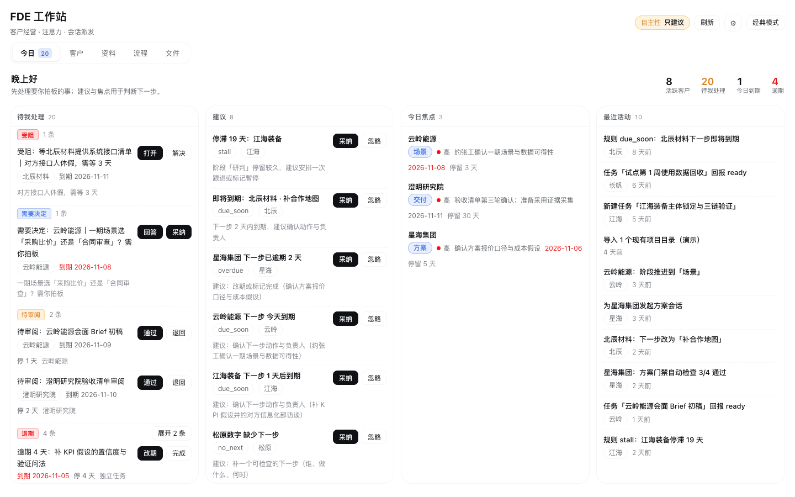
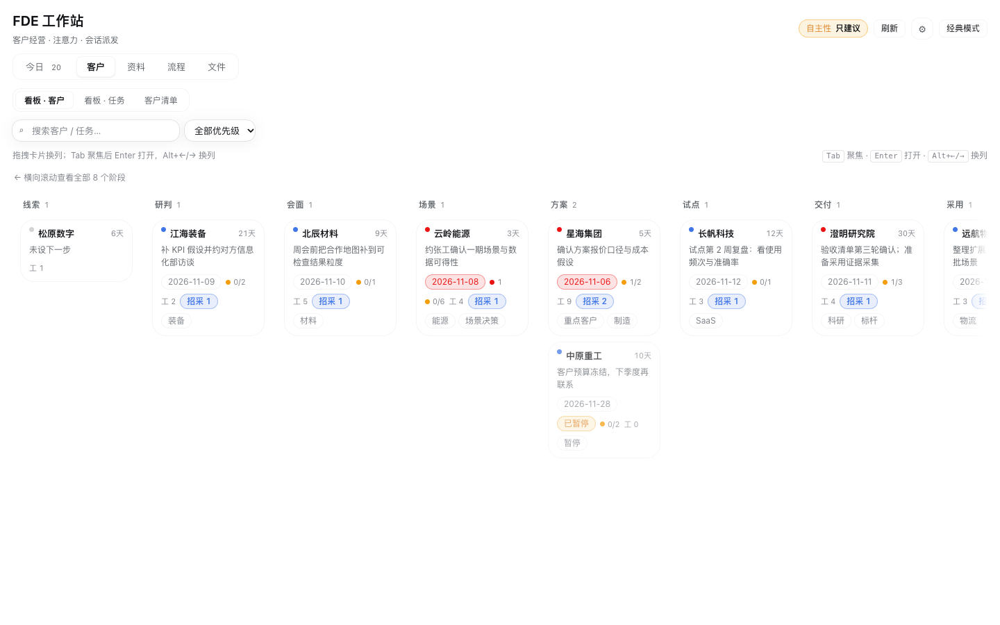

# 10 分钟上手：FDE 工作站（`dsh-fde`）

> 适用版本：**v1.4.0**（DSH `0.2.0-rc.2`）｜ 界面：5 页签 + 页头设置入口
> 这份教程面向第一次安装的人：装好 → 建第一个客户 → 走通一轮「线索到采用」。
> 参考手册见 [README](../README.md)；规格与决策见 [docs/01-spec.md](01-spec.md) 和 [docs/adr/](adr/)。

---

## 0. 你将得到什么

一个跑在 DSH 里的客户经营作战台：客户沿 8 个阶段推进，阶段间有门禁；任务在看板流转；「今日」汇总需要你动手的事；agent 通过会话执行并用工具回报。





---

## 1. 前置检查（30 秒）

| 检查 | 怎么查 | 期望 |
|---|---|---|
| DSH 版本 | 设置 → 关于，或 `dsh --version` | `0.2.0-rc.2`（`engines.dsh` 允许 `>=0.2.0-rc.2 <0.3.0`） |
| Node | `node -v` | ≥ 20 |
| 工作区 | 你准备做客户经营的目录 | 有一个 `research/` 目录（没有也能启动，但看板会提示并跳过；插件会写 `research/.fde/`） |
| 端口/权限 | 能打开 DSH Web GUI | 插件路由走本机回环，无需额外配置 |

> 招采功能依赖独立插件 `bid-intel`（只读本地索引）。没装不影响其它功能，招采页会显示「未就绪」并降级。

---

## 2. 安装

三种方式任选其一；**装完必须重启 DSH**（或在「设置 → 插件」里对 `dsh-fde` 禁用→启用一次），宿主半才会生效。

```bash
# A. npm（1.4.0 发布后可用；先确认 npm 上 latest 版本）
dsh plugin --profile web add dsh-fde

# B. GitHub 直装（main 分支 = 最新代码，当前推荐）
git clone https://github.com/NeoJubao/dsh-fde.git
dsh plugin --profile web add ./dsh-fde

# C. tarball
npm pack ./dsh-fde
dsh plugin --profile web add ./dsh-fde-1.4.0.tgz
```

可选：安装助手只做预检、不改你的 profile 文件：

```bash
cd dsh-fde
python3 tools/install_profiles.py        # 检查环境并打印官方安装命令
python3 tools/install_profiles.py --run  # 确认无误后执行 dsh plugin add
```

**怎么确认装好了**

1. 重启后侧栏出现「FDE 工作站」入口（图标是四个方块）。
2. 设置 → 插件列表里能看到「FDE 工作站」，版本与安装的一致（`locale/` 元数据生效，不会显示成包名）。
3. 点开面板：看到 5 个页签「今日 / 客户 / 资料 / 流程 / 文件」，右上角有刷新、自主性徽章和齿轮。

---

## 3. 第一次打开：5 个页签

| 页签 | 页内子页签 | 什么时候用 |
|---|---|---|
| **今日** | — | 每天先看这里：顶部一行 KPI + 一屏四宫格（待我处理 / 建议 / 今日焦点 / 最近活动），宽屏 4 列、窄屏单列 |
| **客户** | 看板·客户 / 看板·任务 / 客户清单 | 推进客户阶段、管任务、查客户表 |
| **资料** | 资料库 / 招采 | 查方法资料、查招采公告 |
| **流程** | 8 阶段流程 / 方法库 / 技能与模板 | 不确定某阶段该产出什么、该读哪篇方法 |
| **文件** | — | 找客户产物（md/pdf/docx）、导出 PDF |
| **设置**（齿轮） | — | 自主性、阈值、数据源、生财授权、健康检查 |

> 如果看到的是「宿主需要重启 DSH 后启用 FDE 看板」兼容页，说明宿主半还没加载：重启 DSH，或先在插件管理里禁用→启用一次。兼容页保留「经典模式」入口，不会白屏。

---

## 3.5 第一次打开：示例数据（只读）

新装、工作区还没有客户时，面板会自动进入**演示模式**（只读）：

- 顶部横幅：「演示模式：以下为示例数据，不会写入真实看板」；
- 「今日」「客户」里会显示 4 个示例客户（名字带「（示例）」）+ 3 个示例任务，让你先看清工具长什么样；
- 演示期间所有操作（拖拽、新建、门禁、启动会话）都会被拦截并提示，**不会写入任何数据**；
- 两个出口：
  - **开始使用（清除示例）**：一键清除，示例以后不再出现，进入真实空态；
  - **了解功能**：跳到「流程」页看 8 阶段地图。
- 清除后想再看：设置（齿轮）→「演示数据」→「重新查看示例数据」。有真实客户时不会显示示例。

---

## 4. 建第一个客户（2 分钟）

点「客户」→ 右上「**新建客户**」：

| 字段 | 说明 |
|---|---|
| 公司全称 | 必填；用于生成客户卷目录名（`research/<名称>-<日期>/`） |
| 来源 | 例如「招标公告」「转介绍」「公开演讲」；来源必须可追溯 |
| 下一步 | 写清「谁、做什么、何时」；这是看板和今日的驱动字段 |
| 优先级 | 高 / 中 / 低 |

提交后：看板「线索」列出现卡片，并自动打开客户抽屉。你也可以点「**导入现有项目**」，扫描 `research/` 下已有目录，确认后导入（不会自动写盘）。

> 工作区落点：客户卷在 `<workspace>/research/<客户>/`；看板状态在 `<workspace>/research/.fde/`。插件不把客户数据发到外部。

---

## 5. 每日入口：「今日」

- **待我处理**：按类型分组（受阻 / 需要决定 / 待审阅 / 需要回答 / 逾期 / 门禁待确认），每组默认显示前 2 条，点「展开」看全部；每行最多两个操作，其余收进「⋯」。
- **建议**：规则生成的下一步建议（例如「停滞 19 天，建议安排一次跟进」），可「采纳」（转成任务）或「忽略」。
- **今日焦点 / 最近活动**：快速回到最重要的客户与最新变化。
- 顶部「刷新」和「自主性」徽章**只有壳层一处**，页内不再重复。

---

## 6. 推进：看板与门禁

### 6.1 三种视图

- **看板·客户**：8 列（线索 → 采用），拖拽卡片换阶段；卡片显示优先级、停留天数、下一步、门禁进度、工件数、招采徽章。
- **看板·任务**：5 列（待办 / 进行中 / 等外部 / 待我审 / 已完成），按客户筛选；WIP 上限在设置里配。
- **客户清单**：表格视图，适合批量查找与筛选。

### 6.2 门禁怎么工作

把客户从左列拖到下一阶段时，如果该阶段门禁未过，会弹出缺项清单：

- **自动项**：宿主检查工作区里是否有对应产物（如 `research/<客户>/00-项目档案.md`、事实核查清单、Brief、方案、验收清单等）。
- **人工项**：你在客户抽屉里勾选并填写证据（例如「已与对方确认」），才会记录为已确认。

> 重要：门禁只能由人通过。agent 可以准备材料、提示缺项、写建议，但不能替你推进阶段或勾选门禁（调用会被拒绝并返回原因）。

### 6.3 让 agent 干活（handoff）

客户抽屉右下角「**启动会话**」：

1. 面板按当前阶段模板新建一个 DSH 会话，并把客户上下文与阶段任务带进去；
2. agent 执行时会调用 `fde_*` 工具（看板、回报、门禁、资料库等）；
3. 完成或受阻时用 `fde_item report` 回报：`ready`（待你审）/ `blocked`（等外部）/ `failed`（失败继续处理）；
4. 回到面板刷新，「待我审」里出现它的回报，你审阅通过后进「已完成」。

---

## 7. 走通一轮：8 个阶段

| # | 阶段 | 关键产物 | 自动项示例 | 人做什么 |
|---|---|---|---|---|
| 1 | 线索 | `00-项目档案.md` | 档案存在、公司名/来源非空、有下一步 | 判断值不值得进研判 |
| 2 | 研判 | 主体锁定、事实核查清单、KPI 与痛点假设 | 事实核查（A/B/C 分级）、KPI 假设文件 | 确认主体归属与关键假设 |
| 3 | 会面 | 现场 Brief、研判底稿、合作地图、会面记录 | Brief 与记录存在 | 决定是否进「场景」 |
| 4 | 场景 | `scoping/场景评估.md`、数据可得性清单、范围边界 | 场景评估 + 四条硬门槛（有姓名发起人 / 14 天首次对接 / 90 天上线 / 使用可测） | 决定做不做、先做哪个 |
| 5 | 方案 | 方案、成本测算、报价单/SOW、风险登记 | `cost` + `quote` 文件、pricing_confirmed 人工项 | 复核报价与承诺 |
| 6 | 试点 | 试点方案（时间门限/基线/指标/验收/退出/转正）、客户确认、复盘 | 试点方案与确认记录 | 决定是否扩大 |
| 7 | 交付 | 实施计划、验收清单、风险登记、变更单 | 验收清单与计划存在 | 确认交付范围 |
| 8 | 采用 | 使用证据、价值证明、扩展地图 | 采用证据存在 | 判断是否续约/扩展 |

> 每阶段的目标、输入、关键动作、交付物、工具、常见坑，面板「流程 → 8 阶段流程」里都有原文；方法正文在「流程 → 方法库」。

---

## 8. 资料、招采、文件

- **资料库**：本期重点推荐 + 来源组分段（国外官方 / 国内官方 / 开源 / 方法模板 / 社区动态），可按类型、阶段、关键词筛选；「刷新」只刷新本块数据。
- **招采**：本地索引检索（招标 / 中标 / 候选 / 提及）。三条口径要记住：
  1. **候选人 ≠ 中标人**：候选人公示只是评标排序，只有中标/成交公告代表中标；
  2. **批次/专项是推断**，不是公告明示；
  3. **金额只引原文**，口径不一，不换算、不求和。
- **文件**：按客户/阶段聚合产物；可「在 Finder 中打开」「导出 PDF」。PDF 只在明确要打印/递交/发文件时导出，默认交付 md。

---

## 9. 设置（页头齿轮）

| 设置项 | 说明 |
|---|---|
| **自主性** | `只建议`（默认）/ `建议+一键执行` / `安全动作自动`。三档都**不会**自动推进阶段、过门禁、发材料、删客户——这些永远是人的红线 |
| 停滞天数 | 客户在阶段停留超过 N 天且无活动 → 判定停滞，进今日建议 |
| WIP 上限 | 「进行中」任务超过 N 个时看板提示 |
| 数据源开关 | 目录监听 / 打开即出简报 / 招采雷达（关掉对应规则不再生成建议） |
| 生财情报授权 | 三路任选：**链接授权**（推荐，存本机 `research/.fde/scys-auth.json`，可一键清除）/ 环境变量 `FDE_SCYS_TOKEN` / 兼容旧 scys-mcp token 文件 |
| 健康检查 | 一键跑宿主自检，失败项会指出缺哪个文件/服务 |

---

## 10. 让 agent 用起来（推荐开场话术）

在 DSH 会话里可以直接说：

```text
用 FDE 工作站看一下今天该处理什么。
帮我给「某集团」建客户，来源是公开招标，下一步是周三前约到信息部访谈。
把「某集团」从研判推进到会面（先列出门禁缺什么，不要替我过门禁）。
按 fde-meeting 技能准备现场 Brief，基于 research/<客户>/ 里现有材料。
```

agent 会先读看板（`fde_board` / `fde_brief`），再按阶段加载技能（`fde-engagement` / `fde-discovery` / …）。它不能替你过门禁；需要你决定的事会以「注意力」推到今日。

---

## 11. 升级 / 回滚 / 卸载

```bash
# 升级（npm 渠道）
dsh plugin --profile web add dsh-fde@latest

# 升级（本地 checkout）
cd dsh-fde && git pull

# 卸载
dsh plugin --profile web remove dsh-fde
```

- **宿主半**（`index.js`、`src/host/`）改动：重启 DSH，或插件管理里禁用→启用。
- **客户端半**（`client.js`）：刷新页面即可。
- **回滚看板状态**：删除 `<workspace>/research/.fde/`（客户卷 `<workspace>/research/<客户>/` 不受影响）；`research/.fde/backups/` 保留最近 10 份 board 快照。
- **回滚插件**：`dsh plugin remove` 后安装旧版本；或解包你安装前的快照。

---

## 12. 故障排查

| 现象 | 可能原因 | 处理 |
|---|---|---|
| 侧栏没有「FDE 工作站」 | 插件未安装/未启用、宿主未重启 | `dsh plugin --profile web why dsh-fde` 查安装；重启 DSH 或禁用→启用 |
| 面板显示兼容页 | 宿主半未加载（旧进程） | 重启 DSH；或先进「经典模式」继续用旧功能 |
| 页面 404 / 路由不存在 | 客户端新、宿主旧（或反向） | 重启宿主 + 刷新页面，两半版本要一致 |
| 招采显示「未就绪」 | 未安装 `bid-intel` 或索引路径不对 | 安装/升级 `bid-intel`；没有它其它功能不受影响 |
| 生财情报 `UNAUTHORIZED` | 未授权/过期/文件损坏 | 设置里重新「链接授权」，或配 `FDE_SCYS_TOKEN`；不要手改 token 文件 |
| 导出 PDF 失败 | 缺 `python3`/`weasyprint`/`poppler` | 按 `scripts/make-pdf.sh` 的依赖装好；或改用 md 交付 |
| 拖拽不生效 | 浏览器/宿主拦截，或门禁缺项弹窗 | 用卡片操作菜单，或先补门禁缺项；刷新后重试 |
| 看板数据不对/冲突 | 多实例同时写 | 一个工作区只开一个写入实例；刷新重试（有 revision 乐观并发保护） |
| 升级 DSH 后功能异常 | 宿主预览版有破坏性变更 | 回滚插件版本；对照 `engines.dsh` 与 `docs/RELEASE.md` |

---

## 13. 隐私与边界（FAQ）

- **数据在哪？** 客户卷在 `<workspace>/research/<客户>/`；看板与缓存只在 `<workspace>/research/.fde/`。插件不上传客户数据。
- **会对外发送吗？** 不会自动发。对外材料导出必须由人触发；插件不调用任何外部写接口。
- **唯一外联是什么？** 资料库的 GitHub 指标（无 token）与生财 MCP（需你显式授权）；都可以在设置里关闭对应数据源。
- **多人/多实例？** 这是单机单工作区插件；多实例同时写看板只有 revision 乐观并发，没有跨进程锁。
- **它不是什么？** 不是 CRM（不管合同/回款/金额预测）、不是 IM、不是多 agent 调度平台。
- **定价/评分/门禁是标准吗？** 都是方法默认值与实践总结，不构成行业标准；对外报价与合规判断必须由人复核。

---

## 附录 A · 命令速查

```bash
# 安装/升级/卸载
dsh plugin --profile web add dsh-fde
dsh plugin --profile web add dsh-fde@latest
dsh plugin --profile web remove dsh-fde

# 本地开发自检（在插件仓库）
node build.mjs                 # 生成 client.js，校验字节一致
node verify/all.mjs            # 全量验证
node scripts/health-check.mjs  # 健康检查
node verify/ui-contract.mjs    # UI 契约 advisory（drift 数）
node scripts/release-preflight.mjs  # 发布预检
```

## 附录 B · 名词表

| 词 | 含义 |
|---|---|
| engagement / 客户 | 一个客户经营对象，沿 8 阶段推进 |
| item / 任务 | 看板 5 列里的工作项 |
| attention / 注意力 | 需要人决定/审阅/回答/解阻的事，推到「今日」 |
| gate / 门禁 | 进入下一阶段前的自动检查 + 人工确认 |
| handoff / 启动会话 | 面板按阶段模板发起 DSH 会话，agent 执行并回报 |
| drift | UI 契约体检的偏差项数；0 表示当前实现与契约一致 |

## 相关文档

- [README](../README.md)（能力、安装、边界）
- [docs/01-spec.md](01-spec.md)（规格：阶段/门禁/路由/工具）
- [docs/ui-contract/](ui-contract/)（结构/视觉/取值契约）
- [docs/RELEASE.md](RELEASE.md)（发布与回滚）
- [docs/DEVELOPING.md](DEVELOPING.md)（想改代码/加功能看这份）
